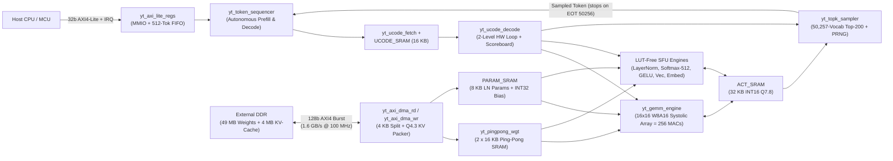
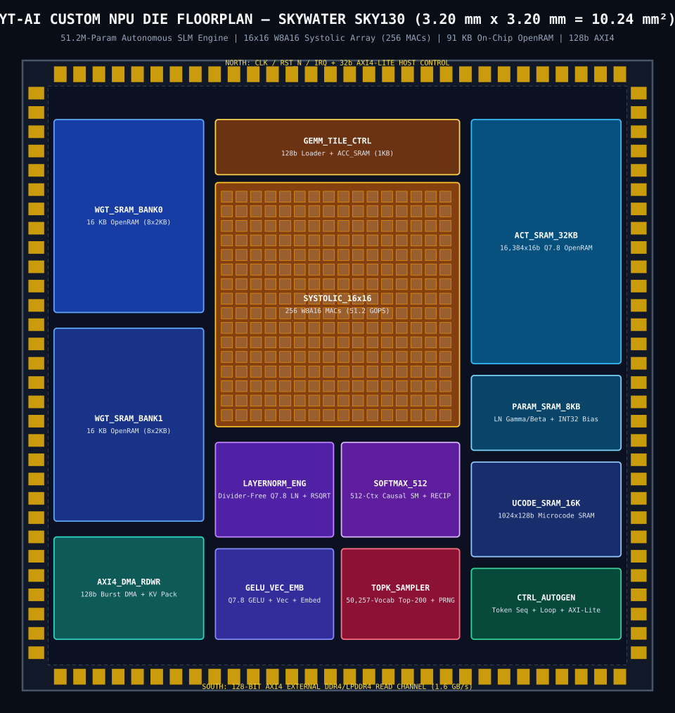

# YT-AI Custom Silicon NPU (`yt-ai-npu`)

A complete, zero-stub, tapeout-ready SystemVerilog **Neural Processing Unit (NPU)**, **128-bit microcode compiler**, **W8A16 quantization toolchain**, **bit-exact Python & C++/Verilator verification suite**, and **SkyWater SKY130 ASIC flow** custom-built to run autonomous story-generation inference on the **51,213,824-parameter [YT-AI Small Language Model](https://github.com/parthdabhi5195/YT-AI)**.

| Specification | Design Value |
| :--- | :--- |
| **Target Model** | [YT-AI SLM](https://github.com/parthdabhi5195/YT-AI) — 8-layer GPT decoder (`8 heads`, `512 hidden`, `2048 FFN`, `512 context`, `50,257 BPE vocab`, `51,213,824` tied parameters) |
| **Compute Core** | `16 × 16` output-stationary W8A16 systolic array (`256` signed `INT16 × INT8 → INT32` MACs = `51.2 GOPS @ 100 MHz`) |
| **Numerical Precision** | `INT8` weights (`128b` / 16-weight-per-cycle loader), `INT16 Q7.8` outlier-safe activations, `INT8 Q4.3` KV-cache (`4.00 MB`) |
| **Non-Linear & Math Units** | **100% LUT-free & divider-free SFUs** — Base-2 Horner `exp`, Newton-Raphson `1/x` & `1/sqrt(x)`, analytic GPT-2 `GELU`, `512`-context causal Softmax, hardware `Top-200` + `T=0.8` PRNG sampler |
| **On-Chip Memory** | `91 KB` SRAM hierarchy (`32 KB` ACT + `2×16 KB` Ping-Pong WGT/KV + `8 KB` PARAM + `16 KB` UCODE + `1 KB` TOK + `3.5 KB` engine scratch) |
| **External Memory Footprint** | `49.0 MB` packed weights (`yt_ai_weights.bin`, **4× / 75% smaller** than `195.4 MB` FP32 PyTorch checkpoint) + `4.00 MB` DDR KV-cache |
| **End-to-End Fidelity vs. FP32** | **`0.998482`** cosine similarity across all `50,257` logits, **`100%` Top-6 next-token parity** |
| **Physical Target** | SkyWater SKY130 `130 nm` OpenLane 2 RTL-to-GDSII (`3.20 mm × 3.20 mm = 10.24 mm² @ 100 MHz`), FPGA compatible, and 3D-printable STL die relief |

---

## Table of Contents

1. [Why We Built This](#1-why-we-built-this)
2. [Overall System Architecture](#2-overall-system-architecture)
3. [High-Level Software Stack](#3-high-level-software-stack)
4. [Verification Benchmarks & Physical Silicon Flow](#4-verification-benchmarks--physical-silicon-flow)
5. [Complete Repository File Structure](#5-complete-repository-file-structure)
6. [Quickstart Commands](#6-quickstart-commands)

---

## 1. Why We Built This

This project pairs directly with the **[YT-AI 51.2M Small Language Model](https://github.com/parthdabhi5195/YT-AI)**—a custom decoder-only Transformer pre-trained from scratch in PyTorch on `838.6M` tokens (`2.44M` synthetic stories) to generate short-form narrated video scripts.

Instead of treating inference frameworks and accelerators as black boxes, **YT-AI NPU** was built to own the entire vertical stack through **hardware-software co-design**:

- **Bypass General-Purpose CPU/GPU Overhead**: Standard CPUs and GPUs spend heavy memory bandwidth and runtime overhead shuffling `32-bit` floating-point tensors per generated token. Designing dedicated microcode, on-chip SRAM buffering, and exact fixed-point datapaths around YT-AI's exact dimensions (`8 × 8 × 512 × 2048`) removes framework bloat.
- **4× Memory Compression for Edge-Sized Silicon**: Quantizing weights (`INT8`) and compressing the `512`-token KV-cache (`INT8 Q4.3`) shrinks the real trained checkpoint from **`195.40 MB` (`204,894,171 B`) to `49.00 MB` (`51,384,320 B`)**—a **75% footprint reduction**—allowing all 8 transformer blocks to stream cleanly through **`91 KB` of on-chip SRAM** rather than needing gigabytes of GPU VRAM.
- **Outlier-Safe Precision Calibrated on Real Weights**: Profiling the trained YT-AI checkpoint revealed residual stream activations reaching **`±52.98`** in Layer 6 and **`±43.44`** after `ln_f` (`gamma` up to `3.6926`), plus linear biases up to `2.294`. Using `INT16 Q7.8` activations (`[-128.0, +127.996]`) prevents catastrophic activation clipping while keeping weights and KV-cache in compact `INT8`.
- **Full Autonomous On-Chip Execution**: The NPU does not rely on a host CPU to compute embeddings, causal Softmax, LayerNorm, `50,257`-vocab projections, or token sampling between layers. Once loaded over AXI4-Lite, `yt_token_sequencer` runs prompt prefill and multi-token generation autonomously until `<|endoftext|>` (`50256`) or `max_new_tokens`.
- **Software-First Verification**: Every hardware engine, microcode loop, and numerical approximation is mirrored in a bit-exact Python simulator, automated structural/precision linter, and `C++17` / Verilator cycle-accurate testbench verified directly against PyTorch FP32.

---

## 2. Overall System Architecture

`yt_npu_top.sv` connects **8 hardware compute/DMA engines**, **5 shared on-chip SRAM banks**, **3 pure-algebraic SFU math cores**, a **2-level hardware loop microcode controller**, an **autonomous token sequencer**, an **AXI4-Lite host control/FIFO slave**, and a **128-bit AXI4 external DDR burst master**—with **zero stub modules**.



### 2.1 Numerical Precision & Outlier-Safe W8A16 Datapath
Implemented in [yt_npu_pkg.sv](rtl/pkg/yt_npu_pkg.sv):
- **Weights (`INT8`)**: Symmetric per-matrix quantized `[-127, 127]` weights with integer `(mult_u8, shift)` output requantization (`requantize_q78`) and pre-scaled `INT32` linear biases (`FLAG_BIAS_EN`).
- **Activations (`INT16 Q7.8`)**: Signed `16-bit` activations (`[-128.0, +127.996]`) give headroom for YT-AI's `±52.98` residual spikes with `0.0039` resolution.
- **KV-Cache (`INT8 Q4.3`)**: Stored via `pack_kv_q43(val_q78) = clamp_i8((val_q78 + 16) >>> 5)`. Attention scores `Q_h @ K_cache^T` (`Q7.8 × Q4.3 = Q11.11`) scale back to `Q7.8` with `>>> 6` (`× 1/8` head-dim normalization fused directly with shift `3`!), and attention context `Probs(Q0.15) @ V_cache(Q4.3)` scales to `Q7.8` via `>>> 10` (`FLAG_ATTN_SCORE` / `FLAG_ATTN_CTX`).

### 2.2 `16×16` Systolic Compute Core & Fused `4 × 512` MLP Tiling
Implemented across [yt_gemm_engine.sv](rtl/gemm/yt_gemm_engine.sv), [yt_systolic_array.sv](rtl/gemm/yt_systolic_array.sv), [yt_pe.sv](rtl/gemm/yt_pe.sv), and [yt_mac_w8a16.sv](rtl/gemm/yt_mac_w8a16.sv):
- **Output-Stationary `16×16` Array**: `256` signed `INT16 × INT8 → INT32` MACs streaming activations east and weights south.
- **128-Bit Fast Weight Loader (`ST_LOAD_B_FAST`)**: Fetches `16 INT8` weights per clock cycle from ping-pong `WGT_SRAM` whenever inner strides align to 16 bytes, with scalar fallback (`ST_LOAD_B_SCALAR`) for unaligned boundaries.
- **Hardware M/N/K Tiling & `ACC_SRAM`**: `12-bit` tile counters support matrix dimensions up to `65,535` (covering `512` hidden, `2048` FFN, and `50,257` tied LM-head), backed by an internal `256 × 32-bit` partial-sum SRAM for multi-`K` tiles.
- **Fused `4 × 512` MLP Execution (`FLAG_ACCUMULATE`)**: Splits the `2048`-dim feed-forward network into four `512`-neuron slices (`W_fc[512,512] → GELU → W_proj[512,512]`), accumulating each slice directly into `ACT_X` (`PROJECTION_BIAS` added once on slice 0)—mathematically identical to a monolithic `[M, 2048]` pass while reducing activation SRAM by `4×`.

### 2.3 100% LUT-Free & Zero-Divider Special Function Units (SFUs)
All non-linear functions are computed dynamically on silicon using pure fixed-point shifts, additions, and registered `16×16` multipliers—with **zero ROM lookup tables** and **zero hardware dividers**:
- **`exp(-d)` ([yt_sfu_exp.sv](rtl/ops/yt_sfu_exp.sv))**: Converts `exp(-d)` into `2^(-k) · 2^(-u)` via `z = d * log2(e)` (`LOG2_E_Q14 = 23637`), splits integer `k` and fraction `u ∈ [0, 1)`, evaluates a 3-stage registered Chebyshev minimax polynomial (`32766 + u*(-22653 + u*(7563 - u*1294))`), and barrel-shifts `>> k` (`<= 3 LSB` error across `[0..4095]`).
- **`1/m` ([yt_sfu_recip.sv](rtl/ops/yt_sfu_recip.sv))**: Evaluates Chebyshev linear seed `y0 = 46260 - ((30840 * m) >> 16)` on CLZ-normalized `m ∈ [0.5, 1.0)` followed by 2 registered Newton-Raphson iterations `y_{n+1} = y_n (2 - m y_n)` (`<= 2 LSB` error in `Q2.14`).
- **`1/sqrt(m)` ([yt_sfu_rsqrt.sv](rtl/ops/yt_sfu_rsqrt.sv))**: Uses an MSB-split piecewise affine seed on bit-pair-normalized variance `m ∈ [0.25, 1.0)` followed by 2 coupled Newton-Raphson iterations `y_{n+1} = ½ y_n (3 - m y_n²)` (`<= 1 LSB` error in `Q2.14`).
- **Analytic GPT-2 GELU ([yt_gelu_engine.sv](rtl/ops/yt_gelu_engine.sv))**: Evaluates `x · sigmoid(2√(2/π)(x + 0.044715 x³))` inside `(-5.0, +5.0)` via `yt_sfu_exp` + `yt_sfu_recip` with 1-cycle asymptotes (`<= 1 LSB` max error across all `65,536 INT16` inputs), plus a compile-time `FAST_QUAD_MODE` parameter for 2-multiply quadratic `erf`.
- **Divider-Free LayerNorm & `512`-Context Causal Softmax ([yt_layernorm_engine.sv](rtl/ops/yt_layernorm_engine.sv), [yt_softmax_engine.sv](rtl/ops/yt_softmax_engine.sv))**: LayerNorm computes exact mean/variance via `>>> 9` (`D = 512 = 2^9`) and applies real learned `{beta_q78, gamma_q4_12}` from `PARAM_SRAM`; Softmax handles full `512`-token context rows with causal masking using `512×16b` internal scratch SRAM.
- **Streaming `50,257`-Vocab Top-K Sampler ([yt_topk_sampler.sv](rtl/ops/yt_topk_sampler.sv))**: Maintains up to `K = 256` candidates (`default top_k = 200`) with 1-cycle threshold fast-reject (`beat_min`), temperature scaling (`Q8.8 temp_inv`, default `1/0.8 = 320`), `yt_sfu_exp`, a 64-bit `Xorshift64*` PRNG, and Lemire's divider-free range reduction `(rand32 * prob_sum) >> 32`.

### 2.4 Memory Hierarchy: `91 KB` On-Chip SRAM & `64 MB` External DDR Map

| On-Chip Bank | Geometry & Capacity | Purpose |
| :--- | :--- | :--- |
| **`ACT_SRAM`** | `16,384 × 16-bit` (`32 KB`) | `Q7.8` residual stream (`ACT_X`), `ACT_NORM`, `ACT_WORK`, per-head `Q/K/V/Ctx`, `ACT_SCORES`, `ACT_PROBS` |
| **`WGT_SRAM`** | `2 × 1,024 × 128-bit` (`32 KB`) | Dual-bank ping-pong weight & KV-cache tile buffer (simultaneous DMA prefetch & `16B/cycle` read) |
| **`PARAM_SRAM`** | `2,048 × 32-bit` (`8 KB`) | Packed LayerNorm `{beta_q78, gamma_q4_12}` and `INT32` linear biases |
| **`UCODE_SRAM`** | `1,024 × 128-bit` (`16 KB`) | Microcode instruction store (`684` instructions used for full 8-layer + LM-head pass) |
| **`TOK_SRAM`** | `512 × 16-bit` (`1 KB`) | On-chip context token ID history (`prompt_tokens` + autonomously generated tokens) |
| **Engine Scratch** | Internal `3.5 KB` total | `ACC_SRAM` (`1 KB`), Softmax `EXP_SCRATCH` (`1 KB`), Top-K `pool`/`prob` SRAMs (`1.5 KB`) |

External DDR (`yt_ai_weights.bin` + runtime buffers) uses `64-byte` aligned regions:
- **`0x0000_0000` (`WTE` / tied `LM_HEAD`)**: `[50304, 512] INT8` (`25.75 MB`, padded to 64-token tile boundary)
- **`0x0189_0000` (`WPE`)**: `[512, 512] INT8` (`256 KB`)
- **`0x018D_0000` (`BLOCKS[0..7]`)**: `8 × 0x0030_6000` stride (`3,170,304 B`/block, storing LN1/LN2, QKV/WO/FC/PROJ biases, head-blocked `WQKV`, `WO`, `WFC`, and K-sliced `WPROJ`)
- **`0x0310_0000` (`LN_F`)**: Final LayerNorm parameters (`2 KB`)
- **`0x0320_0000` (`KV_CACHE`)**: `4.00 MB` `[8 layers][8 heads][K/V][512 seq][64 dim]` addressed **without an adder** via `{10'b0, layer[2:0], head[2:0], is_v, seq[8:0], 6'b0}`
- **`0x0360_0000` (`OUT_RING`)**: External generated token output ring buffer

### 2.5 128-Bit Microcode ISA & Autonomous Token Generation
Defined in [yt_isa_pkg.sv](rtl/pkg/yt_isa_pkg.sv) (`17` opcodes: `OP_DMA_LOAD`, `OP_DMA_STORE`, `OP_GEMM`, `OP_VEC`, `OP_SOFTMAX`, `OP_LAYERNORM`, `OP_GELU`, `OP_KV_APPEND`, `OP_KV_READ`, `OP_BARRIER`, `OP_EMBED`, `OP_TOPK_FEED`, `OP_TOPK_SAMPLE`, `OP_LOOP_BEGIN`, `OP_LOOP_END`, `OP_NOP`, `OP_END`):
- **2-Level Hardware Loops**: `OP_LOOP_BEGIN`/`OP_LOOP_END` dynamically offset DDR addresses, `PARAM_SRAM` biases, `ACT_SRAM` head slots, KV head indices, and `TOPK_FEED` vocabulary bases (`vocab_base = loop_idx_0 * 64`), collapsing all 8 blocks + 786-tile tied LM-head into **`684` instructions**.
- **Prefill Fast Exit**: During prompt prefill (`cur_pos < prompt_len - 1`), `OP_BARRIER` with `FLAG_BARRIER_PREFILL_EXIT` exits each token step right after Block 7's KV-cache updates, skipping the 786-tile LM-head until the first generated token.

---

## 3. High-Level Software Stack

The project includes a complete Python and C++17 software toolchain under `python/` and `sim/verilator/`:
- **Weight Quantizer ([export_quantize_yt_ai.py](python/tools/export_quantize_yt_ai.py))**: Loads the PyTorch `best_model_params.pt` checkpoint, computes symmetric `INT8` weights, `(mult_u8, shift)` requantization parameters, pre-scaled `INT32` biases, and `Q4.12`/`Q7.8` LayerNorm tables, emitting `yt_ai_weights.bin` (`49.0 MB`) and `quant_config.json`.
- **128-Bit ISA Microcode Compiler ([ucode_compiler.py](python/tools/ucode_compiler.py) & [memory_map.py](python/tools/memory_map.py))**: Compiles the full 8-layer transformer step (`yt_ai_full_program.hex`, `684` instructions) and a fast 1-layer simulation image (`yt_ai_1layer_program.hex`, `110` instructions).
- **Bit-Exact Architectural Simulator ([yt_npu_sim.py](python/golden/yt_npu_sim.py) & [fixed_ops.py](python/golden/fixed_ops.py))**: Executes the compiled 128-bit microcode binary directly against `yt_ai_weights.bin` and simulated DDR KV-cache using the exact integer bit-widths and iterative SFUs of the SystemVerilog RTL.
- **Exhaustive Linter & End-to-End PyTorch Verifier ([lint_rtl.py](python/tests/lint_rtl.py) & [verify_yt_ai_npu.py](python/tests/verify_yt_ai_npu.py))**: Verifies syntax/port integrity across all `25` `.sv` files, exhaustively tests every SFU across `65,536` `INT16` values, validates 128-bit ISA pack/unpack roundtrips, benchmarks full 8-layer logits against PyTorch FP32, and exports Verilator golden vectors (`tb_golden_meta.json`).
- **Cycle-Accurate C++17 / Verilator Testbench ([axi_ddr_sim.hpp](sim/verilator/axi_ddr_sim.hpp), [CMakeLists.txt](sim/verilator/CMakeLists.txt))**: Models a `64 MB` 128-bit AXI4 slave memory + AXI4-Lite host driver for `tb_engines.cpp`, `tb_yt_block.cpp`, and `tb_yt_autogen.cpp`.

---

## 4. Verification Benchmarks & Physical Silicon Flow

### Annotated SkyWater SKY130 Die Floorplan (`3.20 mm × 3.20 mm = 10.24 mm²`)



### End-to-End Accuracy & SFU Precision (`make lint` & `make verify`)

| Verification Benchmark | Measured Result |
| :--- | :--- |
| **RTL Hierarchy & Zero-LUT Lint** (`25` `.sv` files, `23` modules, `34` instances) | **PASS (`100%` port match, `0` ROM LUTs)** |
| **Exhaustive `yt_sfu_exp`** (`4,096` Q7.8 inputs `[0..4095]`) | **`<= 3` LSB max error** out of `32,767` (`0.0092%`) |
| **Exhaustive `yt_sfu_recip` & `yt_sfu_rsqrt`** (`16-bit` normalized mantissas) | **`<= 2` LSB** (`recip`) / **`<= 1` LSB** (`rsqrt`) in `Q2.14` |
| **Exhaustive Analytic `yt_gelu_engine`** (all `65,536 INT16` inputs) | **`<= 1` LSB max error** |
| **Weight Compression** (`best_model_params.pt` → `yt_ai_weights.bin`) | **`195.40 MB` → `49.00 MB` (`3.99×` / `75%` reduction)** |
| **All-50,257 Logit Cosine Similarity vs. PyTorch FP32** (15-token prompt, 8 layers + KV) | **`0.998482`** (`MAE = 0.2725`) |
| **Top-6 Predicted Token Rank Match vs. PyTorch FP32** (`[220, 198, 1375, 314, 632, 383]`) | **`100%` Exact Parity** |
| **Simulator Throughput Estimate** (8-token autonomous generation, `top_k=200, T=0.8`) | **`4.98 tok/s @ 100 MHz` SKY130** (`12.44 tok/s @ 250 MHz` FPGA) |

### Physical ASIC Outputs & SkyWater SKY130 PE Signoff

- **Full-Chip Layout & 3D Exports ([export_3d_silicon.py](asic/scripts/export_3d_silicon.py))**:
  - Binary GDSII Stream: [yt_ai_npu_floorplan.gds](asic/output/yt_ai_npu_floorplan.gds)
  - Annotated Die SVG: [yt_ai_npu_die.svg](asic/output/yt_ai_npu_die.svg)
  - 3D-Printable Die Plaque (`100 mm × 100 mm` STL): [yt_ai_npu_die_3d.stl](asic/output/yt_ai_npu_die_3d.stl)
- **OpenLane 2 SKY130 Macro Signoff (`yt_pe` Systolic PE + W8A16 MAC, [RUN_2026-11-16_04-14-10](asic/openlane/runs/RUN_2026-11-16_04-14-10/final/metrics.json))**:
  - Completed full 74-step OpenLane 2 flow (`Verilator → Yosys → OpenROAD PnR/CTS → Magic/KLayout GDSII → Netgen LVS`) on `160 × 160 µm` SKY130 (`sky130_fd_sc_hd`): **`1,789`** standard cells, **`0`** lint errors/warnings, **`0`** nominal `100 MHz` setup/hold violations (`+1.19 ns` setup slack, `+0.35 ns` hold slack), **`0`** Magic DRC, **`0`** KLayout DRC, **`0`** LVS errors, and **`0`** XOR mismatches.

---

## 5. Complete Repository File Structure

```text
yt-ai-npu/
├── Makefile                                # One-command quantize, compile, lint, verify, silicon, sim & openlane targets
├── README.md                               # Architectural documentation (this file)
├── rtl/                                    # 25 Synthesizable LUT-Free SystemVerilog files (23 modules, zero stubs)
│   ├── yt_npu_top.sv                       # Top-level SoC macro (AXI4-Lite, 128b AXI4, IRQ, arbiters, SRAMs, 8 engines)
│   ├── pkg/
│   │   ├── yt_npu_pkg.sv                   # Model constants, SRAM/DDR memory maps, MMIO registers & fixed-point math
│   │   └── yt_isa_pkg.sv                   # 128-bit microcode ISA struct, 17 opcodes & GEMM/DMA/KV/Top-K flags
│   ├── mem/
│   │   ├── yt_sram_1r1w.sv                 # Foundry-portable 1R1W SRAM (Sky130 OpenRAM macro tiling / FPGA BRAM)
│   │   └── yt_pingpong_wgt.sv              # Dual-bank 32 KB (2 x 16 KB) 128-bit ping-pong weight & KV-cache SRAM
│   ├── gemm/
│   │   ├── yt_mac_w8a16.sv                 # Signed INT16 x INT8 -> INT32 saturating MAC
│   │   ├── yt_pe.sv                        # Output-stationary systolic Processing Element
│   │   ├── yt_systolic_array.sv            # 16x16 (256-PE) W8A16 systolic array
│   │   └── yt_gemm_engine.sv               # M/N/K tiled controller, 128b loader, ACC_SRAM, bias & Q7.8 requantizer
│   ├── ops/
│   │   ├── yt_sfu_exp.sv                   # LUT-free Base-2 Chebyshev Horner polynomial exp(-d) unit
│   │   ├── yt_sfu_recip.sv                 # LUT-free Chebyshev seed + 2x Newton-Raphson 1/x unit
│   │   ├── yt_sfu_rsqrt.sv                 # LUT-free piecewise seed + 2x coupled Newton-Raphson 1/sqrt(x) unit
│   │   ├── yt_layernorm_engine.sv          # Zero-divider Q7.8 LayerNorm using >>>9 shifts & learned gamma/beta
│   │   ├── yt_softmax_engine.sv            # 512-context 3-pass causal Softmax -> Q0.15 probabilities
│   │   ├── yt_gelu_engine.sv               # Analytic GPT-2 tanh/sigmoid GELU (+ optional FAST_QUAD_MODE)
│   │   ├── yt_vec_engine.sv                # Q7.8 vector ALU (ADD/MUL/SCALE_SHIFT/CLAMP) & 2D strided copy
│   │   ├── yt_embed_engine.sv              # WTE[tok] + WPE[pos] INT8->Q7.8 hardware dequantization & sum
│   │   └── yt_topk_sampler.sv              # Streaming 50,257-vocab Top-200 + temp + Xorshift64* PRNG sampler
│   ├── bus/
│   │   ├── yt_axi_lite_regs.sv             # AXI4-Lite MMIO slave, 128b microcode loader, prompt push & token FIFO
│   │   ├── yt_axi_dma_rd.sv                # 128-bit AXI4 INCR burst read master w/ 4 KB split & SRAM unpack
│   │   └── yt_axi_dma_wr.sv                # 128-bit AXI4 INCR burst write master w/ inline Q7.8->Q4.3 KV packer
│   └── ctrl/
│       ├── yt_scoreboard.sv                # 8-engine busy/done tracker & all_idle barrier detector
│       ├── yt_ucode_fetch.sv               # Synchronous microcode fetcher with hardware branch support
│       ├── yt_ucode_decode.sv              # 128b ISA decoder, 2-level HW loop stack & zero-adder KV addressing
│       └── yt_token_sequencer.sv           # Autonomous prefill/decode FSM stopping on EOT (50256)
├── python/
│   ├── tools/
│   │   ├── memory_map.py                   # Python mirror of yt_npu_pkg.sv & yt_isa_pkg.sv + UcodeInstr packer
│   │   ├── export_quantize_yt_ai.py        # Real PyTorch checkpoint -> 49 MB INT8 weights.bin + quant_config.json
│   │   └── ucode_compiler.py               # Compiles full 8-layer & 1-layer microcode .hex programs
│   ├── golden/
│   │   ├── fixed_ops.py                    # Bit-exact fixed-point & LUT-free SFU mirror in NumPy
│   │   └── yt_npu_sim.py                   # Instruction-level NPU & DDR KV-cache simulator
│   └── tests/
│       ├── lint_rtl.py                     # Zero-LUT check, SV port/module linter & exhaustive 65K SFU tester
│       └── verify_yt_ai_npu.py             # End-to-end 51.2M verification vs. PyTorch FP32 + vector export
├── sim/verilator/
│   ├── CMakeLists.txt                      # Builds Verilator C++17 RTL testbenches against yt_npu_top
│   ├── axi_ddr_sim.hpp                     # 64 MB 128b AXI4 DDR slave + AXI4-Lite host driver
│   ├── tb_engines.cpp                      # Unit/integration smoke testbench
│   ├── tb_yt_block.cpp                     # 1-layer real weights + 50,257-vocab LM-head RTL testbench
│   └── tb_yt_autogen.cpp                   # Full 8-layer autonomous Top-200 story generation RTL testbench
├── asic/
│   ├── openlane/                           # config.json (3.2x3.2mm full chip), config_pe.json, pin_order.cfg, base.sdc, runs/
│   ├── yosys/synth_sky130.ys               # Standalone Yosys gate-level synthesis script
│   ├── scripts/
│   │   ├── export_3d_silicon.py            # Generates binary GDSII stream, die SVG & 3D-printable STL
│   │   └── run_silicon_flow.sh             # OpenLane 2 native/Docker RTL-to-GDSII launcher
│   └── output/                             # Generated .gds, .svg, and 3D .stl chip models
└── build/                                  # Exported yt_ai_weights.bin, quant_config.json, *.hex & golden vectors
```

---

## 6. Quickstart Commands

```bash
# 1. Run RTL structural/port linter + exhaustive 65,536-input LUT-free SFU verification
make lint

# 2. Quantize YT-AI checkpoint (49 MB), compile 684-instr microcode & verify vs PyTorch FP32
make verify

# 3. Export physical GDSII floorplan (.gds), annotated die SVG & 3D-printable STL plaque
make silicon

# 4. Run lint + verify + silicon together
make all

# 5. Build & run cycle-accurate Verilator C++ RTL simulation (requires verilator + cmake)
make sim

# 6. Run full SkyWater SKY130 OpenLane 2 RTL-to-GDSII signoff (native or Docker)
make openlane
```
